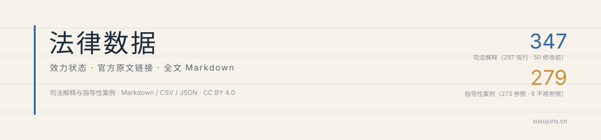
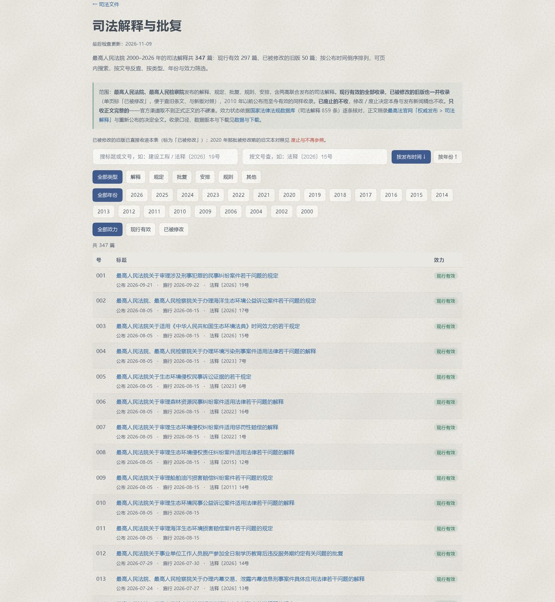

<p align="center">
  
</p>

<p align="center">
  <a href="https://susujuris.cn/documents.html"></a>
  <a href="https://github.com/susuxuefa/law-data/releases"></a>
  
  
  <a href="https://orcid.org/0009-0005-3241-7366"></a>
  <a href="LICENSE"></a>
</p>

<p align="center"><strong>带效力状态的中文法律数据：哪条还有效、旧版改了什么、案例还能不能引。</strong></p>

<p align="center">347 条司法解释（297 现行有效 · 50 修改前旧版）+ 279 篇最高人民法院指导性案例，<br>全文 Markdown，元数据 CSV / JSON，每条带文号、公布与施行日期、官方原文链接。</p>

<p align="center">
  
</p>

*Chinese judicial interpretations and guiding cases with validity status — full text in Markdown, metadata in CSV / JSON, official source link on every record.*

## 为什么会有这个库

法律文本到处都有，难的是三件事：

1. **这条司法解释还有效吗？** 只以官方发布为准：国家法律法规数据库（flk.npc.gov.cn）的效力状态逐条核对，官方库里已废止的 158 条整条不收；已被修改的，旧版照收但标「已被修改」，方便新旧对照——引用旧文书时最需要看到的就是它。
2. **指导案例还能不能引？** 279 篇里 6 篇已被通知「不再参照与适用」（法〔2020〕343 号、法〔2026〕119 号），文件头标 `status: 不再参照`，不混进正常案例。
3. **引用时怎么给出处？** 每篇带文号／案例编号、公布与施行日期、官方链接，可直接进脚注。

在线阅读：<https://susujuris.cn/documents.html>　数据说明与引用格式：<https://susujuris.cn/data.html>

## 目录

| 路径 | 内容 | 数量 |
|---|---|---|
| `judicial-interpretations/` | 司法解释全文（Markdown + YAML 头） | 347 |
| `guiding-cases/` | 最高人民法院指导性案例全文（Markdown + YAML 头） | 279 |
| `data/shifashi.json / .csv` | 司法解释元数据（含效力状态、制定机关） | 347 |
| `data/guiding-cases.json / .csv` | 指导性案例元数据（含效力状态） | 279 |
| `data/shifashi-amended.json` | 修改前旧版清单 29 条 + 修改决定 28 份 | — |
| `MANIFEST.json` | 版本、数量、来源、许可 | — |
| `STATUS.md` | 收录口径、已知缺口、待办 | — |

字段：

- 司法解释：`n / slug / title / type / fsNo / pubDate / impl / status / organ / url`（Markdown 头另有 `passed` 通过日期与 `checked` 核对日期）
- 指导性案例：`n / title / plain / cause / year / pub / url / kw / laws`（Markdown 头另有 `status` 与 `checked`）
- `status` 取值：司法解释 `现行有效` / `已被修改`；指导性案例 `参照适用` / `不再参照`

## 怎么用

- **读**：直接打开 Markdown，文件头的 YAML 有文号、日期、效力与官方链接；
- **查**：CSV 用 Excel／WPS 打开（UTF-8 带 BOM，中文不乱码），按类型、年份、效力筛选；
- **建**：JSON 导入 SQLite／Notion，或作为检索、RAG 的目录层（正文再回官方链接）。

只想拿现行有效的司法解释：

```bash
jq -r '.[] | select(.status=="现行有效") | [.fsNo, .title] | @tsv' data/shifashi.json
```

```python
import json, pandas as pd
d = pd.DataFrame(json.load(open("data/shifashi.json", encoding="utf-8")))
print(d[d.status == "现行有效"].shape[0], "条现行有效")
```

- **引**：

```
苏酥. 中国司法解释与指导性案例数据（v2026.12）[DB/OL]. 苏酥学法, 2026-11-09.
https://susujuris.cn/data.html.
```

## 版本与更新

版本号形如 `v2026.12`，每次核对在 [STATUS.md](STATUS.md) 记一条变更，并在 [Releases](https://github.com/susuxuefa/law-data/releases) 发布。

- `v2026.12`（2026-11-09）：司法解释 259 → 347（效力状态改以国家法律法规数据库为准，已被修改的旧版一并收录并标注）；两个目录补齐全文；元数据加 `status` / `organ`。
- `v2026.11`（2026-10-23）：补 9 条缺失字段；新增 `data/shifashi-amended.json`。
- `v2026.10`（2026-10-21）：首次发布，司法解释 259 条、指导性案例 279 条。

## 参与

发现错漏、状态过期、官方链接失效，欢迎开 issue 或直接 PR，见 [CONTRIBUTING.md](CONTRIBUTING.md)。报错只需要说清**哪一条**和**依据链接**，不用先成为贡献者才能提问。

## 许可

- **正文**：国家机关官方文件，依《著作权法》第五条不受著作权保护，可自由复制、转载、摘编，商用无需许可；
- **整理成果**（筛选口径、效力标注、字段结构）：[CC BY 4.0](LICENSE)。署名「苏酥学法」并链接回 <https://susujuris.cn/data.html> 是请求，不是限制。

## 相关项目

- [Just Laws](https://github.com/ImCa0/just-laws)：开源中国法律文库，法律原文清晰可读；
- [Laws](https://github.com/LawRefBook/Laws)：按法典结构整理的法律文本；
- [苏酥学法](https://susujuris.cn/)：法经济学笔记、概念库与站内检索（1059 个页面，纯静态）。
