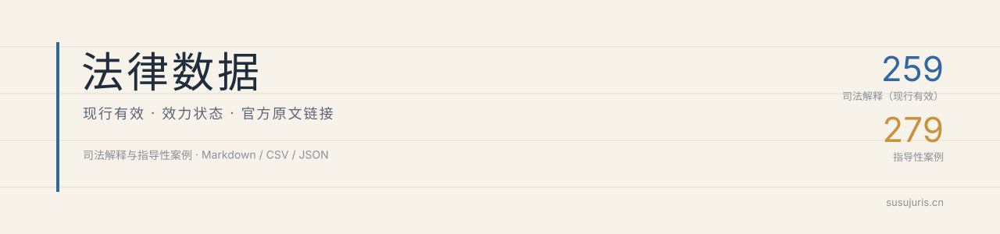

<p align="center">
  
</p>

<p align="center">
  <a href="https://susujuris.cn/documents.html"></a>
  <a href="https://github.com/susuxuefa/law-data/releases"></a>
  
  
  <a href="https://orcid.org/0009-0005-3241-7366"></a>
  <a href="LICENSE"></a>
</p>

<p align="center"><strong>甯︽晥鍔涚姸鎬佺殑涓浗娉曞緥鏁版嵁锛氬摢鏉¤繕鏈夋晥銆佹渚嬭繕鑳戒笉鑳藉紩銆佸嚭澶勫湪鍝噷銆?/strong></p>

## 涓轰粈涔堜細鏈夎繖涓簱

娉曞緥鏂囨湰鍒板閮芥湁锛岄毦鐨勬槸涓変欢浜嬶細

1. **杩欐潯鍙告硶瑙ｉ噴杩樻湁鏁堝悧锛?* 鍙敹鐜拌鏈夋晥鏂囨湰锛涘凡搴熸銆佸凡琚慨鏀圭殑鏃ф枃鏈墧闄わ紝骞惰褰曚緷鎹紱
2. **鎸囧妗堜緥杩樿兘涓嶈兘寮曪紵** 279 绡囬噷 6 绡囧凡琚€氱煡銆屼笉鍐嶅弬鐓т笌閫傜敤銆嶏紝濡傚疄鏍囨敞锛屼笉娣疯繘姝ｅ父妗堜緥锛?3. **寮曠敤鏃舵€庝箞缁欏嚭澶勶紵** 姣忕瘒甯︽枃鍙凤紡妗堜緥缂栧彿銆佸叕甯冧笌鏂借鏃ユ湡銆佸畼鏂归摼鎺ワ紝鍙洿鎺ヨ繘鑴氭敞銆?
鍦ㄧ嚎闃呰锛?https://susujuris.cn/documents.html>锛堝徃娉曟枃浠跺叆鍙ｏ級

鏁版嵁鑾峰彇涓庤鏄庯細<https://susujuris.cn/data.html>

## 鐩綍

| 璺緞 | 鍐呭 | 鏁伴噺 |
|---|---|---|
| `judicial-interpretations/` | 鐜拌鏈夋晥鍙告硶瑙ｉ噴鍏ㄦ枃锛圡arkdown + YAML 澶达級 | 259 |
| `guiding-cases/` | 鏈€楂樹汉姘戞硶闄㈡寚瀵兼€ф渚嬪叏鏂囷紙Markdown + YAML 澶达級 | 279 |
| `data/shifashi.json / .csv` | 鍙告硶瑙ｉ噴鍏冩暟鎹?| 259 |
| `data/guiding-cases.json / .csv` | 鎸囧鎬ф渚嬪厓鏁版嵁 | 279 |
| `MANIFEST.json` | 鐗堟湰銆佹暟閲忋€佹潵婧?| 鈥?|
| `STATUS.md` | 鏀跺綍鍙ｅ緞銆佸凡鐭ョ己鍙ｃ€佸緟鍔?| 鈥?|

瀛楁锛?
- 鍙告硶瑙ｉ噴锛歚n / slug / title / type / fsNo / pubDate / impl / url`
- 鎸囧鎬ф渚嬶細`n / title / plain / cause / year / pub / url / kw / laws`

## 鎬庝箞鐢?
- **璇?*锛氱洿鎺ユ墦寮€ Markdown锛屾枃浠跺ご鐨?YAML 鏈夋枃鍙枫€佹棩鏈熴€佹晥鍔涗笌瀹樻柟閾炬帴锛?- **鏌?*锛欳SV 鐢?Excel锛廤PS 鎵撳紑锛屾寜绫诲瀷銆佸勾浠姐€佹柦琛屾棩鏈熺瓫閫夛紱
- **寤?*锛欽SON 瀵煎叆 SQLite锛廚otion锛屾垨浣滀负妫€绱€丷AG 鐨勭洰褰曞眰锛堟鏂囧啀鍥炲畼鏂归摼鎺ワ級锛?- **寮?*锛?
```
鑻忛叆. 鏈€楂樹汉姘戞硶闄㈢幇琛屾湁鏁堝徃娉曡В閲婂簱锛坴2026.10锛塠DB/OL]. 鑻忛叆瀛︽硶, 2026-10-21.
https://susujuris.cn/data.html.
```

## 鐗堟湰涓庢洿鏂?
鐗堟湰鍙峰舰濡?`v2026.11`锛屾瘡娆℃牳瀵瑰湪 [STATUS.md](STATUS.md) 璁颁竴鏉″彉鏇达紝骞跺湪 [Releases](https://github.com/susuxuefa/law-data/releases) 鍙戝竷銆?
鐘舵€佸垽鏂緷鎹渶楂樹汉姘戞硶闄㈠巻娆″簾姝€佷慨鏀瑰喅瀹氾紙鍚硶閲娿€?020銆?6鍙锋皯娉曞吀閰嶅娓呯悊娓呭崟锛夛紝涓庡畼鏂规鏂囦氦鍙夋瘮瀵广€傛鏂囦互瀹樻柟鍙戝竷涓哄噯銆?
## 鍙備笌

鍙戠幇閿欐紡銆佺姸鎬佽繃鏈熴€佸畼鏂归摼鎺ュけ鏁堬紝娆㈣繋寮€ issue 鎴栫洿鎺?PR锛岃 [CONTRIBUTING.md](CONTRIBUTING.md)銆備笉鐢ㄥ厛鎴愪负璐＄尞鑰呮墠鑳芥彁闂€?
## 璁稿彲

- **姝ｆ枃**锛氬浗瀹舵満鍏冲畼鏂规枃浠讹紝渚濄€婅憲浣滄潈娉曘€嬬浜旀潯涓嶅彈钁椾綔鏉冧繚鎶わ紝鍙嚜鐢卞鍒躲€佽浆杞姐€佹憳缂栵紝鍟嗙敤鏃犻渶璁稿彲锛?- **鏁寸悊鎴愭灉**锛堢瓫閫夊彛寰勩€佹晥鍔涙爣娉ㄣ€佸瓧娈电粨鏋勶級锛歔CC BY 4.0](LICENSE)銆傜讲鍚嶃€岃嫃閰ュ娉曘€嶅苟閾炬帴鍥?<https://susujuris.cn/data.html> 鏄姹傦紝涓嶆槸闄愬埗銆?
## 鐩稿叧椤圭洰

- [Just Laws](https://github.com/ImCa0/just-laws)锛氬紑婧愪腑鍥芥硶寰嬫枃搴擄紝娉曞緥鍘熸枃娓呮櫚鍙锛?- [鑻忛叆瀛︽硶](https://susujuris.cn/)锛氭硶缁忔祹瀛︾瑪璁般€佹蹇靛簱涓庣珯鍐呮绱€?
